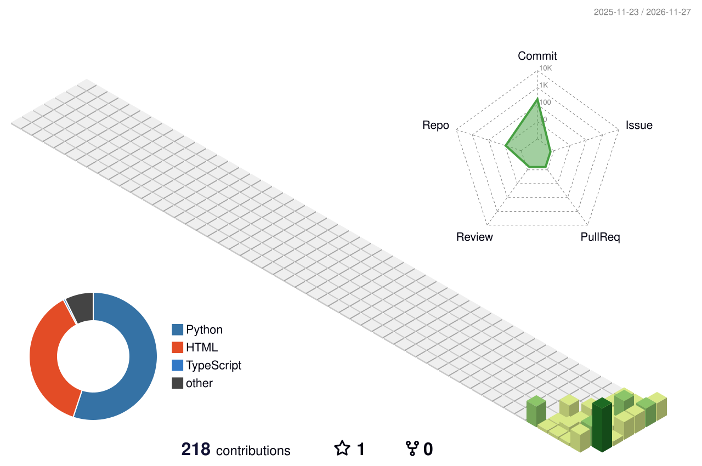

  <b>Fresher Data Analyst</b> · B.Tech in AI &amp; Data Science · Data Science &amp; Analytics Intern @ Nexgen Analytics, Pune (May–Nov 2025)

  🎯 Open to <b>Data Analyst</b> roles — based in Maharashtra, looking in Mumbai / Pune

  
  
  

## 🚀 What I'm Building Now

- 🔍 **[Novara](https://tanmaymaind.github.io/private-search-engine-by-Tanmay-Maind-/)** — a private search engine. No history, no account, no tracking. Voice search, AI answers, instant answers — improved every single day.
- 🤖 **[100 Days of AI &amp; ML](https://github.com/tanmaymaind/100-days-ai-ml)** — one small, real AI/ML project every day, from linear regression from scratch to NLP, computer vision and deep learning.

## 🛠️ Tech Stack

  

<i>Python · SQL · Pandas · Excel · Power BI</i>

## 📌 Featured Projects

- 📊 **[Daily Python & SQL for Data Analysis](https://github.com/tanmaymaind/daily-python-sql)** — one small exercise a day: the same business questions answered in Python (pandas) and SQL, side by side.
- 📈 **[Excel Sales Analysis](https://github.com/tanmaymaind/excel-sales-analysis)** — 1,200 orders analysed in Excel with live formulas (VLOOKUP, SUMIFS, IF), a region summary and a dashboard. Total net revenue ₹2,72,83,819.
- 📉 **[Telecom Customer Churn Prediction](https://github.com/tanmaymaind/tele-custmer-churn)** — ML project that predicts which customers are likely to leave, so the company can reach them early.

## 📊 GitHub Stats

  
  

  

## 📈 Activity Graph

## 🏙️ 3D Contribution Graph

  

## 🐍 Contribution Snake

<picture>
  <source media="(prefers-color-scheme: dark)" srcset="dist/github-contribution-grid-snake-dark.svg" />
  <source media="(prefers-color-scheme: light)" srcset="dist/github-contribution-grid-snake.svg" />
  
</picture>

